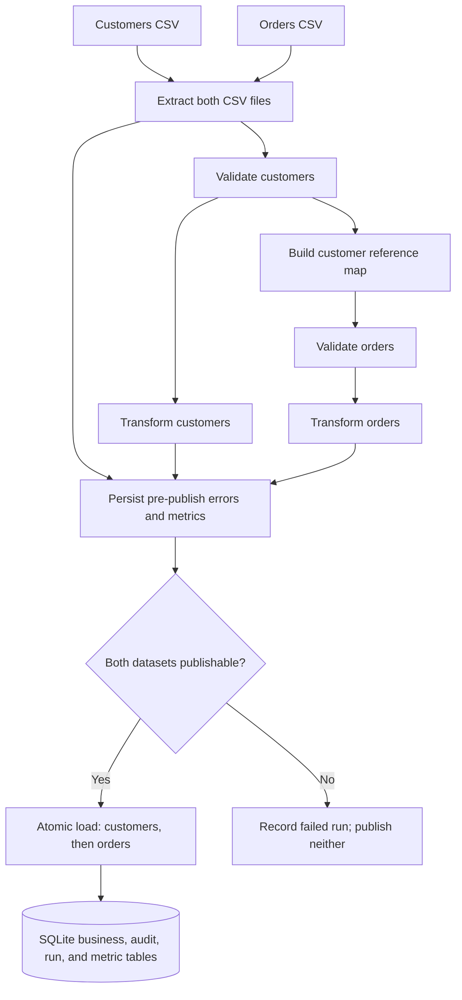

# Reusable Data Engineering Pipeline Framework

## Project Overview

This project is a local, reusable data engineering framework for processing
two related datasets: customers and orders. It addresses the need for a
repeatable way to extract source data, validate its structure and business
rules, transform records consistently, and publish trustworthy results for
downstream use.

The pipeline is implemented as separate Python modules for extraction,
validation, transformation, SQLite loading, orchestration, and operational
metrics. It preserves source information for rejected records, tracks each run,
and reports reconciliation counts so that data-quality issues are visible
rather than silently discarded.

The current implementation is designed for local CSV files and SQLite. It is
a tested vertical slice, not a cloud, streaming, or distributed data platform.

## Key Features

- **Two-dataset processing:** Customers and orders are handled in one run.
  Orders are validated against customers and published after them.
- **CSV extraction:** Reads UTF-8 CSV files and records source filename, row
  number, physical line span, and raw record text.
- **Malformed-row handling:** Recoverable field-count mismatches are separated
  from batch-level file, encoding, and CSV syntax errors.
- **Schema and business-rule validation:** Checks headers, required fields,
  field formats, allowed values, duplicate keys, customer references, and the
  order-date versus customer-signup-date rule.
- **Normalization and transformation:** Trims selected fields, normalizes
  email and country code, converts timestamps to UTC, and represents order
  amounts as integer cents.
- **SQLite storage:** Persists customer and order business data with primary
  key, foreign-key, and field constraints.
- **Rejections and audit trail:** Stores rejected source occurrences with
  provenance and reason codes; records accepted outcomes as inserted or
  unchanged.
- **Run IDs and dataset metrics:** Records a UUID run ID, timestamps,
  per-dataset row counts, statuses, and reconciliation status.
- **Atomic publication and rollback:** Publishes customers and orders in one
  transaction. Unexpected failures roll back business inserts and accepted
  audit rows together.
- **Idempotent reruns:** Identical normalized business records are classified
  as unchanged. Existing IDs with different business values are rejected and
  never overwrite stored data.
- **Reconciliation:** Tracks parsed, malformed, rejected, accepted, inserted,
  and unchanged records, leaving unknown metrics as `NULL`.
- **Synthetic data generation:** Creates reproducible customer and order CSVs
  with a configurable random seed.
- **Performance benchmarking:** Measures pipeline stages on generated data,
  using a fresh temporary database for every iteration, and writes JSON/CSV
  results.
- **Automated tests:** Unit and integration tests cover the database,
  extraction, validation, transformation, loading, and orchestration paths.

## Architecture

The orchestration entry point initializes SQLite, starts a run, extracts both
files, validates customers, builds a customer reference map, validates orders,
transforms both datasets, and asks the loader to publish them together.
Known row rejections and batch errors are persisted before publishing; the
loader checks batch completeness before writing either dataset.



See [docs/architecture.md](docs/architecture.md) for the detailed component
design, transaction strategy, and limitations.

## Technology Stack

- **Python 3.14** (project metadata supports `>=3.14,<3.15`)
- **CSV** through Python's standard-library `csv` module
- **SQLite** through Python's standard-library `sqlite3` module
- **Pytest** for automated tests
- **Python standard library** for UUIDs, timestamps, dataclasses, JSON, file
  handling, timing, and temporary directories

`requirements.txt` declares `pandas==3.1.0` and `pytest==9.2.0`. Pandas is
currently listed as a dependency but is not imported or used by the pipeline
implementation; pipeline CSV and SQLite processing uses the standard library.

## Project Structure

```text
.
├── data/
│   ├── sample/
│   │   ├── customers.csv
│   │   ├── orders.csv
│   │   └── .gitkeep
│   └── output/
│       ├── benchmark.csv
│       ├── benchmark.json
│       ├── benchmark_summary.csv
│       ├── benchmark_summary.json
│       ├── pipeline.sqlite
│       └── .gitkeep
├── docs/
│   ├── architecture.md
│   ├── data_dictionary.md
│   ├── performance_benchmark.md
│   └── .gitkeep
├── pipeline/
│   ├── benchmark.py
│   ├── database.py
│   ├── extract.py
│   ├── generate_data.py
│   ├── load.py
│   ├── orchestrate.py
│   ├── transform.py
│   ├── validate.py
│   └── .gitkeep
├── tests/
│   ├── integration/
│   │   ├── test_load_integration.py
│   │   ├── test_orchestrate.py
│   │   └── .gitkeep
│   └── unit/
│       ├── test_database.py
│       ├── test_extract.py
│       ├── test_transform.py
│       ├── test_validate.py
│       └── .gitkeep
├── .gitignore
├── pyproject.toml
├── README.md
└── requirements.txt
```

The sample CSVs contain 1,000 customers and 5,000 orders. Files under
`data\output\` are local generated outputs and are ignored by Git (except for
the directory's `.gitkeep` placeholder).

## Environment Setup

Use Python 3.14 from the project root in Windows PowerShell:

```powershell
py -3.14 -m venv .venv
.\.venv\Scripts\Activate.ps1
python -m pip install --upgrade pip
python -m pip install -r requirements.txt
```

If PowerShell script activation is restricted or you prefer not to activate the
environment, run commands with the virtual-environment interpreter directly:

```powershell
.\.venv\Scripts\python.exe -m pip install --upgrade pip
.\.venv\Scripts\python.exe -m pip install -r requirements.txt
```

SQLite is provided by Python; no separate database server is required.

## Generate Sample Data

Generate the default 1,000 customer and 5,000 order records, using seed `42`:

```powershell
.\.venv\Scripts\python.exe -m pipeline.generate_data --customers 1000 --orders 5000 --output-dir data\sample --seed 42
```

The generator writes `customers.csv` and `orders.csv` into the selected output
directory, creating it if needed. This command replaces the two sample files
at those paths. To generate a larger dataset or preserve the checked-in sample
inputs, choose different counts and/or an alternate output directory:

```powershell
.\.venv\Scripts\python.exe -m pipeline.generate_data --customers 100000 --orders 500000 --output-dir data\generated --seed 42
```

Orders reference generated customers and are not dated before their referenced
customer's signup date. The standard generator emits valid sample rows; it does
not insert deliberately invalid records.

## Run the Pipeline

Run the sample customer and order files through the pipeline:

```powershell
.\.venv\Scripts\python.exe -m pipeline.orchestrate --database data/output/pipeline.sqlite --customers data/sample/customers.csv --orders data/sample/orders.csv
```

The CLI initializes the SQLite database if necessary, runs both datasets,
prints the run ID, final status, and dataset metrics, and returns exit code 0
for `succeeded` or `completed_with_rejects`. A failed run or a command error
returns a nonzero exit code.

Rerunning the same files against the same database is safe: matching existing
records are reported as unchanged, and existing IDs with different business
content are rejected instead of overwritten.

## Run Tests

Run the complete test suite from the repository root:

```powershell
.\.venv\Scripts\python.exe -m pytest -q
```

**Verified result:** 119 tests passed (`119 passed in 1.67s`).

## Performance Benchmark

The recorded benchmark used 10,000 customers and 50,000 orders, seed `42`,
three independent iterations, and a fresh temporary SQLite database per
iteration. The mean total pipeline duration was **3.143258 seconds** and the
mean combined throughput was **19,131.22 input records per second**. This rate
is the arithmetic mean of the three per-iteration rates for all 60,000 input
records divided by each iteration's total pipeline duration.

Total pipeline time excludes data generation. The measured loading stage
averaged 2.064060 seconds and includes database initialization and run
creation, in addition to publishing; it is not an isolated measurement of SQL
insert time. The recorded runs succeeded with all 10,000 customers and 50,000
orders inserted, zero rejects, zero unchanged records, and complete
reconciliation for both datasets. Hardware specifications were not recorded.

See [docs/performance_benchmark.md](docs/performance_benchmark.md) for the
methodology, per-iteration timings, throughput, reconciliation details, and
limitations. To reproduce a benchmark:

```powershell
.\.venv\Scripts\python.exe -m pipeline.benchmark --customers 10000 --orders 50000 --iterations 3 --seed 42 --output data\output\benchmark
```

The command writes detailed and summary results in JSON and CSV beneath
`data\output\`.

## Data Quality and Reconciliation

The pipeline separates row-level rejections from batch-level errors. Each
rejected source occurrence can be traced through its source filename, logical row number,
physical line positions when available, record key, raw CSV record, and reason
code. Batch-level errors include a processing stage and are recorded separately
rather than being presented as ordinary row rejects.

For completed publishing, accepted rows reconcile as
`rows_accepted = rows_inserted + rows_unchanged`. Rejected records include
malformed rows, parsed validation/transform rejects, and load-stage rejects
(for example, an order whose customer foreign key cannot be satisfied).
Unknown metrics remain `NULL`; an incomplete batch or failed publish is
identified by its failure status and reconciliation status rather than being
reported as a complete reconciliation.

The field-level input contract, database constraints, business rules, and
traceability fields are documented in
[docs/data_dictionary.md](docs/data_dictionary.md).

## Database Design

The SQLite database has seven application tables:

| Table | Purpose |
|---|---|
| `customers` | Customer business records, keyed by `customer_id`. |
| `orders` | Order business records, keyed by `order_id`, with a foreign key to customers. |
| `pipeline_runs` | Run ID, timestamps, overall status, optional configuration, and failure message. |
| `run_dataset_metrics` | Per-dataset input/outcome counts, status, timing, and reconciliation state. |
| `accepted_records` | Audit of accepted source occurrences and whether each was inserted or unchanged. |
| `rejected_records` | Traceable row-level rejects and their reasons. |
| `batch_errors` | Batch-level errors with stage, code, message, and available source context. |

Database creation and connection/transaction helpers are in
[`pipeline/database.py`](pipeline/database.py). No separate database server or
schema migration service is part of this local implementation.

## Design Decisions and Limitations

### Implemented

- Customer validation and reference-map creation precede order validation.
- Customers are published before orders, and both datasets share one atomic
  publishing transaction.
- Known row rejects and batch errors are persisted before publication so they
  remain available if the publish transaction rolls back.
- Same-ID records with identical normalized business fields are unchanged;
  changed business content is a conflict and is never overwritten.
- Rejections and operational outcomes are persisted in SQLite audit and metric
  tables. The command-line interface also prints run status and metrics.
- The pipeline processes local CSV inputs and writes to local SQLite.

### Current limitations

- The implementation does not provide cloud deployment, streaming,
  distributed execution, a scheduler, API ingestion, or a centralized
  monitoring/logging service.
- Extraction, validation, and transformation operate on in-memory result
  collections rather than a streaming/chunked design.
- Business validation is specific to the current customer and order schemas;
  for example, supported order currency is limited to `USD`.
- The benchmark covers one data size and three iterations of generated valid
  data. It does not characterize hardware-independent performance or
  reject-heavy input.
- Loading is the largest measured benchmark stage, but its timing combines
  database setup, run creation, and publishing.

## Future Enhancements

Potential next steps, not currently implemented, include:

- Profile the loading stage in more detail and test parameterized batch
  inserts or other write strategies while preserving transaction and audit
  semantics.
- Add configurable chunking or streaming for larger inputs, with explicit
  handling of cross-chunk duplicate detection and customer references.
- Add more benchmark sizes, workload types, and environment metadata.
- Extend source/target adapters to APIs or cloud storage and add deployment
  configuration if a cloud execution environment is required.
- Add operational dashboards or structured log export on top of the existing
  run, metrics, and audit tables.
- Make dataset rules such as currencies and schema versions configurable when
  additional business requirements call for it.

## Author / Submission

**YottaFlex AI Data Engineering Hackathon submission**

This repository contains the implementation, tests, reproducible sample data,
benchmark artifacts, and technical documentation for the project.
