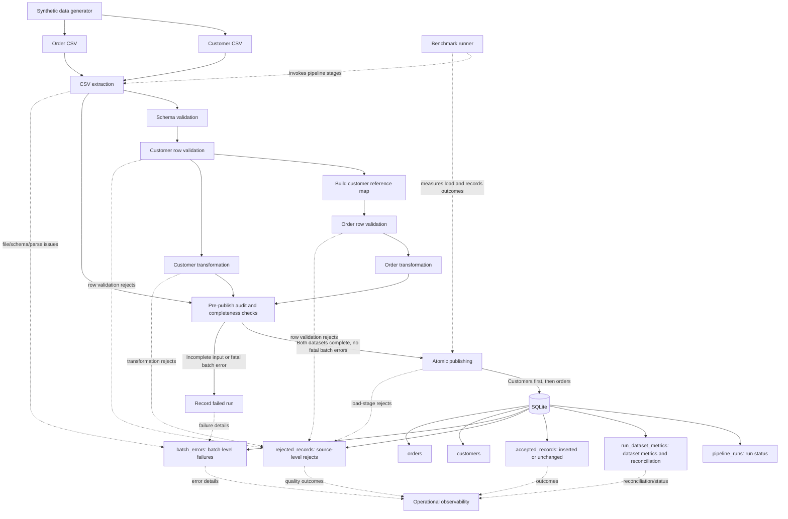

# Data Pipeline Architecture

## 1. Project overview

This project is a reusable, local data pipeline framework for processing two
related datasets: customers and orders. It reads CSV files, preserves source
provenance, validates schemas and business rules, transforms valid rows into
normalized records, and publishes both datasets to SQLite. Operational and
data-quality outcomes are stored so that a run can be inspected and reconciled.

The order dataset depends on the customer dataset: each order must refer to a
known customer, and its UTC date must not precede that customer's signup date.
The framework therefore validates customers and builds a customer reference
map before validating orders.

## 2. Technology stack

| Technology | Use in this project |
|---|---|
| Python | Pipeline implementation, command-line interfaces, generation, and benchmarking. |
| CSV | Input and generated sample format; Python's standard-library `csv` module reads and writes these files. |
| SQLite | Local relational storage, constraints, foreign keys, audit tables, and run metrics. Access uses Python's standard-library `sqlite3` module. |
| Pytest | Automated unit and integration tests. |
| Python standard library | CSV handling, dataclasses, timestamps, UUIDs, JSON/CSV benchmark output, temporary directories, timing, and SQLite access. |
| Pandas | Listed in `requirements.txt`, but not imported or used by the pipeline modules described here. |

The project does not use Pandas to read, transform, or load the pipeline data.
Although it is declared as a dependency, the current pipeline path is based on
the standard library.

## 3. System architecture

The diagram separates batch-level errors from rejected source rows. It also
shows that generator and benchmark are support tools, not runtime stages
required by a normal pipeline invocation. Operational logging in this
implementation means persisted audit/error/metric records and CLI output;
there is no separate logging service or logging module.

## 4. Component responsibilities

| Module | Responsibility and important behavior |
|---|---|
| [`pipeline/database.py`](../pipeline/database.py) | Defines and initializes the SQLite schema and indexes; opens connections with foreign-key enforcement enabled; provides connection and transaction context managers. Transactions use `BEGIN IMMEDIATE`, commit on success, and roll back on exceptions. |
| [`pipeline/extract.py`](../pipeline/extract.py) | Reads UTF-8 CSV files using `csv.reader`, checks required-file availability, and returns immutable extraction result structures. Captures logical row numbers, physical line spans, parsed values, and original raw CSV text. Separates recoverable field-count-malformed rows from fatal batch errors. |
| [`pipeline/validate.py`](../pipeline/validate.py) | Checks exact, case-sensitive headers and dataset rules; validates customer and order fields; checks order references and signup-date chronology; identifies duplicate keys; returns valid source records, row rejections, and batch errors as separate outputs. Provides `build_customer_reference_map()` for order validation. |
| [`pipeline/transform.py`](../pipeline/transform.py) | Normalizes validated customer and order records without modifying source records. Normalizes identifiers and selected text fields, converts timestamps to UTC, converts amounts to Python integers, and reports transform-level row rejects and batch errors. |
| [`pipeline/load.py`](../pipeline/load.py) | Creates run context and initial dataset metric rows, persists pre-publish rejections and batch errors, checks completeness, publishes customers and orders atomically, records accepted/rejected outcomes, finalizes metrics/status, and records failure details after rollback. |
| [`pipeline/orchestrate.py`](../pipeline/orchestrate.py) | Implements `run_pipeline()` and a CLI. Initializes the database, invokes stages in dependency order, then delegates atomic publishing and final result retrieval to the loader. |
| [`pipeline/generate_data.py`](../pipeline/generate_data.py) | Generates deterministic synthetic `customers.csv` and `orders.csv` using the standard library and a configurable seed. Generated orders reference generated customers and do not predate their signup dates. |
| [`pipeline/benchmark.py`](../pipeline/benchmark.py) | Runs configurable benchmark iterations with generated data and a fresh temporary SQLite database per iteration. Measures generation separately from extraction, validation, transformation, loading, and total pipeline execution; exports detailed and summary JSON/CSV. |

The pipeline result types are frozen dataclasses, and the stage outputs retain
source record references so later stages can preserve provenance.

## 5. End-to-end execution flow

The normal entry point is `run_pipeline(database_path, customers_path,
orders_path, config=None)` in `pipeline/orchestrate.py`.

1. **Initialize the database.** `initialize_database()` creates missing tables
   and indexes using `CREATE ... IF NOT EXISTS`; it does not replace existing
   records.
2. **Start a run.** `start_run()` creates a UUID run ID and UTC start timestamp.
   In one committed transaction it stores the `pipeline_runs` row and the
   initial metric rows for both datasets, including source basenames.
3. **Extract both required files.** `extract_required_csv_files()` checks both
   paths before reading either file. If either preflight check fails, it
   returns batch errors and no extracted file results. Otherwise, each file is
   parsed and its complete or partial extraction result is retained.
4. **Validate customers.** `validate_customers()` checks the customer header
   and row rules, including duplicate handling.
5. **Build customer references.** When customer validation is batch-complete,
   `build_customer_reference_map()` creates the normalized customer-ID to
   signup-date mapping required by order validation.
6. **Validate orders.** `validate_orders()` checks order fields, customer
   references, duplicate order IDs, and that the order's UTC date is not before
   signup. If customer schema validation prevents a reliable reference map,
   orchestration records an order-level dependency batch error instead of
   marking all orders as unknown-customer row rejects.
7. **Transform both datasets.** `transform_customers()` and
   `transform_orders()` produce normalized records and keep validation rejects
   and transformation rejects available to the loader.
8. **Record and preflight results.** `publish_batch()` persists known
   pre-publish row rejections, batch errors, and computable input counts in a
   separate transaction. It then verifies that both datasets have complete
   extraction and no fatal batch errors. If not, it publishes neither.
9. **Publish atomically.** The loader inserts customers before orders in one
   transaction, writes accepted audit rows in that same transaction, and
   finalizes dataset and run metrics/statuses before committing.
10. **Return a result or raise.** On successful commit, `publish_batch()`
    returns a `LoadResult` with the run status and per-dataset metrics. A
    post-commit failure to read that result is surfaced but does not relabel
    the committed run as failed. Fatal processing errors before publishing are
    recorded by orchestration; publishing errors are recorded by the loader.

The CLI accepts `--database`, `--customers`, and `--orders`. It prints the run
ID, final status, and customer/order metrics, and returns exit code 0 for
`succeeded` or `completed_with_rejects`; failures return a nonzero code.

## 6. Validation and rejection handling

The pipeline keeps file/batch failures separate from row-level rejects so
operators can distinguish a bad batch from individual bad records.

### Schema-level errors

Customer and order headers are exact and case-sensitive. Required columns,
duplicate column names, and unexpected columns are checked by the validation
module. A missing header or a schema mismatch is represented as a `BatchError`
with a stage such as `schema_check`; it is not misrepresented as a row-level
reject. Customer `phone` is an optional column; order columns are required.

If customer schema validation fails, there is no trustworthy customer
reference map. Orchestration adds a `customer_reference_unavailable`
batch-level validation error for orders and does not produce false
unknown-customer row rejections.

### Recoverable malformed CSV rows

Extraction uses strict CSV parsing. A logical row whose number of fields does
not match the header is retained as a `MalformedCsvRecord`, with its raw text,
source row number, physical line span, and `field_count_mismatch` reason. The
extractor continues reading later rows. By contrast, unrecoverable CSV syntax,
decoding, or read errors become batch errors and may make the extraction
incomplete.

### Row-level validation failures

Validation rules cover required values, name lengths, email format, real
signup dates, assigned country codes, allowed statuses, positive integer
amounts, supported currency, timezone-aware timestamps, customer references,
and order chronology. Duplicate identifiers are compared after trimming:
identical duplicates retain the first occurrence and reject later occurrences;
conflicting duplicate keys reject each conflicting occurrence.

### Transformation failures

Transformation normalizes customer identifiers/names, lowercases email,
uppercases country code, converts order timestamps to UTC, and represents
amounts as integers. Unsupported timestamp precision or values outside
SQLite's signed integer range become transformation-stage row rejections.
Original source records remain attached to transformed and rejected records.

### Load-stage rejection and traceability

The database enforces an order-to-customer foreign key. Expected order foreign
key failures for absent customers are handled at a savepoint and converted to
`invalid_customer_reference` load-stage row rejects. An existing primary key
with changed business fields is rejected as `existing_id_conflict`. These
rejections preserve the source filename, row number, physical line span,
record key, and raw record in `rejected_records`. Each source occurrence is
stored at most once per run/dataset/file/row.

Unexpected database errors are not treated as ordinary row rejects; they
abort the atomic publishing transaction and fail the run.

## 7. Database design

The database module defines seven tables. Business tables hold the current
immutable customer/order records; the remaining tables track execution and
row-level or batch-level outcomes.

| Table | Responsibility |
|---|---|
| `customers` | Customer business records keyed by `customer_id`, with validated/normalized fields, source file and row, `first_seen_run_id`, and load timestamp. |
| `orders` | Order business records keyed by `order_id`, including an enforced foreign key to `customers.customer_id`, source provenance, `first_seen_run_id`, and load timestamp. |
| `pipeline_runs` | One row per execution: UUID `run_id`, UTC start/end times, run status, optional serialized configuration, and failure message. |
| `run_dataset_metrics` | One row per run and dataset (`customers` or `orders`): source file, input and outcome counts, timing, dataset status, reconciliation status, and failure message. |
| `accepted_records` | One audit row for each accepted source occurrence, identifying the run, dataset, source location, record key, and whether it was `inserted` or `unchanged`. |
| `rejected_records` | One traceable row per rejected source occurrence, including source positions, key, reason code/detail, and raw CSV text. Its uniqueness constraint prevents duplicate occurrence entries within a run. |
| `batch_errors` | Batch-level error records with run, optional dataset/source, stage, error code/message, optional physical line, and creation time. |

SQLite foreign-key enforcement is enabled for every connection. The schema also
contains checks for allowed statuses, positive/nonempty values, and metric
reconciliation relationships, plus indexes used for common run/dataset and
record lookups.

## 8. Transaction and failure strategy

The transaction boundaries protect auditability and atomic business publishing:

1. **Run creation:** `start_run()` commits the run row and both initial
   `run_dataset_metrics` rows together, before file processing.
2. **Pre-publish records:** `record_processing_results()` runs separately
   before publication. Known extraction, validation, and transformation
   rejects, batch errors, and available pre-publish counts are persisted so
   they survive a later publish rollback.
3. **Completeness gate:** both required extractions must be complete and there
   must be no fatal batch errors. If this gate fails, no customer or order
   business records are published.
4. **Atomic publish:** customers are considered first, then orders. Business
   inserts, load-stage rejection/acceptance audit rows, final dataset metrics,
   and the final run status are written in one transaction. If an unexpected
   error occurs, this transaction rolls back as a whole; customer inserts
   cannot remain if a later order operation causes a fatal failure.
5. **Expected row-level integrity error:** an order insert uses a savepoint.
   When SQLite identifies a foreign-key violation and the referenced customer
   is absent, the loader rolls back only that savepoint and records a traced
   row rejection. Other unexpected integrity failures propagate and abort the
   whole transaction.
6. **Failure recording:** after a publish rollback, the loader opens a
   separate transaction to persist failure details, any pending load-stage
   rejects, the failed run status, and failed/incomplete dataset status. A
   failure-recording error is surfaced together with the original publishing
   error. For unexpected orchestration errors before publication,
   `orchestrate.py` calls `fail_run()` and re-raises the original error.

Thus, pre-publish rejects and batch errors survive a publication rollback,
while business writes and accepted audit records either commit together or do
not commit.

## 9. Idempotency and immutable records

Business rows are never overwritten by the loader. For a transformed record
whose ID already exists, the loader compares the normalized business fields:

- If all business fields match, the occurrence is classified as `unchanged`;
  it is not inserted again and an `accepted_records` row records the outcome.
- If any business field differs, the occurrence is rejected with
  `existing_id_conflict`; the existing database row remains unchanged.
- If the ID is new, the business row and its accepted audit record are
  inserted in the publish transaction.

This makes rerunning the same normalized input safe with respect to duplicate
business records. Source metadata such as current run ID and load time does
not turn a business-identical rerun into a conflict.

## 10. Metrics and reconciliation

`run_dataset_metrics` stores input counts, validation outcomes, accepted and
rejected counts, inserted and unchanged counts, dataset status, and
reconciliation status. Values that cannot be established are left `NULL`
rather than reported as zero.

The implemented reconciliation relationships are:

- `rows_read = rows_parsed + malformed_rows`
- `rows_parsed = rows_valid_candidates + rows_rejected_parsed`
- `rows_accepted = rows_inserted + rows_unchanged`
- For completed publishing:
  `rows_rejected = malformed_rows + rows_rejected_parsed + load-stage rejects`

The final equation includes records that passed validation but were rejected
during loading, such as an order whose customer foreign key cannot be
satisfied. These are stored in `rejected_records` and count as rejected, not
accepted. On incomplete batches or failed publication, the metrics explicitly
use failure reconciliation statuses; counts unavailable from incomplete input
remain unknown.

Run statuses are `running`, `succeeded`, `completed_with_rejects`, `failed`,
and `abandoned`. Dataset metrics also use `pending`. Reconciliation statuses
are `pending`, `complete`, `incomplete_batch_failure`, and
`incomplete_publish_failure`. A run is `completed_with_rejects` when at least
one source occurrence was rejected; otherwise a successful run is
`succeeded`.

## 11. Performance benchmarking

The measured results in [the performance benchmark report](./performance_benchmark.md)
use 10,000 customers, 50,000 orders, seed `42`, three independent iterations,
and a fresh temporary SQLite database for each iteration. The report records
Python 3.14.10; hardware specifications were not captured.

| Stage | Average duration | Minimum | Maximum |
|---|---:|---:|---:|
| Data generation | 0.538524 s | 0.497462 s | 0.574750 s |
| Extraction | 0.266855 s | 0.238913 s | 0.305669 s |
| Validation | 0.378563 s | 0.336541 s | 0.404323 s |
| Transformation | 0.433772 s | 0.424667 s | 0.449078 s |
| Loading | 2.064060 s | 1.895657 s | 2.193611 s |
| Total pipeline, generation excluded | 3.143258 s | 2.937263 s | 3.261524 s |

Loading was the longest measured pipeline stage in all three iterations. This
timing includes database initialization and run creation in addition to
atomic publishing, so it does not isolate individual SQL operations. Each
iteration succeeded: 10,000 customers and 50,000 orders were accepted and
inserted, with zero rejects and zero unchanged records; both dataset
reconciliations were `complete`.

The report proposes further profiling at varied data sizes and investigating
batch-oriented SQL operations. These are future investigation opportunities,
not measured optimizations; no performance improvement is claimed.

## 12. Design decisions and limitations

### Implemented decisions

- **Explicit stage outputs:** extraction, validation, and transformation
  return immutable structures that distinguish valid records, rejected rows,
  and batch errors.
- **Preserved provenance:** source basename, logical record number, physical
  line span, record key, and raw record are carried forward for rejection
  auditability.
- **Customer-first dependency handling:** orders are only validated against a
  customer reference map produced from batch-complete customer validation.
- **Atomicity with durable diagnostics:** known rejects are committed before
  the publish transaction; business writes and accepted audit entries commit
  together; failure details are written after rollback.
- **No overwrite policy:** same-ID differences are conflicts, not updates.
- **Local and reproducible tooling:** generated data has a fixed-seed option,
  and benchmark iterations use fresh temporary databases.

### Current limitations

- Inputs and target storage are local CSV files and SQLite; no remote object
  store, API source, cloud warehouse, streaming ingestion, scheduler, or
  distributed execution is implemented.
- Dataset rules are intentionally narrow for this project: order currency is
  `USD`, and the schemas represent the customer and order fields documented in
  the data dictionary. Changing these contracts requires deliberate code and
  schema changes.
- The pipeline materializes extraction, validation, and transformation
  results as in-memory tuples. It is not a streaming or bounded-memory
  implementation.
- Operational logging is persisted in the pipeline's run, audit, metrics,
  and batch-error tables, with command-line output; there is no centralized
  log aggregation or monitoring service.
- The benchmark covers one data size, one seed, and three measured iterations
  with valid generated data. Hardware details and performance under malformed
  or reject-heavy workloads were not recorded.
- Loading is currently the dominant measured stage, but the benchmark combines
  initialization, run setup, and publishing. Profiling those sub-operations
  and testing candidate batch SQL approaches are future work, not established
  improvements.
